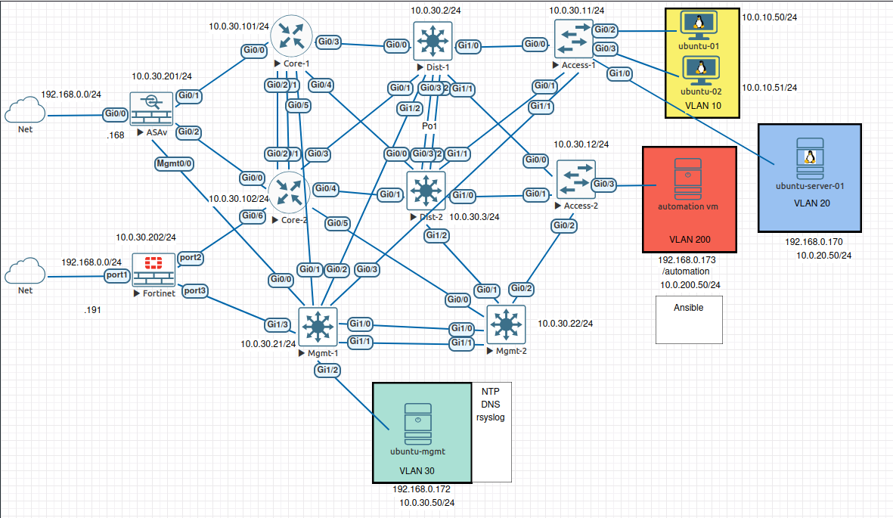

# AI-Assisted Network Automation Lab

An experimental network automation lab built with Proxmox, EVE-NG, Python, Ansible, Cisco switches, routers, linux servers and clients.

The project explores how **AI, network telemetry, and automation** can work together to improve network visibility, troubleshooting, and operational efficiency. The initial focus is classic 3-tier campus network design, with an architecture intended to support broader network automation experiments over time.

## Objectives

- **Network automation:** Automate repetitive tasks through APIs, Python, and Ansible.
- **Telemetry and observability:** Collect and analyze network state, device health, events, and operational data.
- **Topology awareness:** Build an understanding of network devices, links, routing, and dependencies.
- **AI-assisted troubleshooting:** Use locally hosted language models to interpret telemetry, correlate symptoms, and help identify root causes.
- **Controlled remediation:** Explore AI-assisted corrective actions with validation and safeguards.
- **Reproducible experiments:** Use virtual network environments to simulate failures, test hypotheses, and evaluate automation workflows.

## Lab Environment

| Component | Details |
|---|---|
| Virtualization | Proxmox VE |
| Network emulation | EVE-NG |
| Firewall | Cisco Cisco ASAv 9.22(1)1 |
| Core routers | Cisco IOSv 15.9(3)M6 |
| Distribution, access and management switches | Cisco Virtual IOS L2 Experimental Version 15.2 |
| Automation server VM | Ubuntu 22.04.5 LTS |
| Management, Linux server and clients VM | Ubuntu 26.04 LTS |
| Automation tools | Python 3.10, Ansible 2.17 |
| AI platform | Local LLMs with Ollama planned for integration |

## Lab Topology for AdminLan

- Layer 2, layer 3 devices and management server in 10.0.30.0/24 VLAN 30.
- Automation VM in 10.0.200.0/24 in VLAN 200.
- Ubuntu server in 10.0.20.0/24 in VLAN 20.
- Ubuntu clients in 10.0.10.0/24 in VLAN 10.


## Current Implementation

- Authenticate and connect from the automation VM to the devices.
- Retrieve and decode device running configurations, inventory information.
- Running Ansible to retrieve and push configurations.
- NTP,DHCP, rsyslog on Management VM.
- Save results and configuration output for analysis.
- Maintain automation code and lab workflows in version control, GitHub connection.

## Planned Development

### 1. Network Automation

Extend the Python API client and Ansible workflows to automate service VPNs, monitoring configuration, device onboarding, and configuration deployment.

### 2. Telemetry and Topology Awareness

Collect operational data and develop a network model that represents devices, links, routing relationships, and service dependencies.

### 3. AI-Assisted Network Operations

Integrate locally hosted LLMs through Ollama and an appropriate orchestration layer. Provide relevant topology and telemetry context so the AI can assist with state analysis, fault isolation, and root-cause investigation.

### 4. Validation and Remediation

Build repeatable failure scenarios in EVE-NG. Evaluate proposed corrective actions, validate their expected effects, and explore controlled execution with safeguards and post-change verification.

### 5. Documentation and Reproducibility

Document experiments, automation workflows, failure scenarios, and results. Share reusable code and findings through GitHub.

## Main Project Structure

```text
Network-Automation/
├── ansible/                 # Ansible automation
│   └── backups/ 
    ├── inventory
    ├── playbooks          
├── configs/             
├── pki/                 # PKI-related lab files
├── .env                 # Local credentials (not committed)
├── .gitignore
└── README.md
```

## Security and Operational Safety

- Store credentials in a local `.env` file.
- Never commit credentials, session cookies, private keys, or other secrets.
- Use trusted certificates and enable SSL verification outside the lab.
- Treat AI-generated diagnoses and configuration changes as proposals until validated.
- Use explicit safeguards, change validation, and post-change checks when testing automated remediation.

## Project Status

This is an active research and learning project. Basic authentication, inventory retrieval, configuration collection, Ansible playbook running to the devices are working. Broader telemetry integration, AI-assisted analysis, and controlled remediation are development goals.

The long-term objective is to explore a network operations workflow in which **telemetry provides context, topology provides relationships, AI assists with reasoning, and automation executes validated actions**.

## Lab Architecture

The diagram shows the current EVE-NG lab, including the SD-WAN controllers, automation VM, WAN transports, and branch sites.



